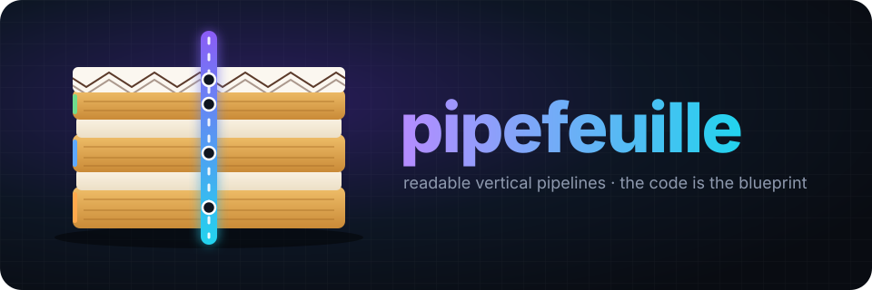
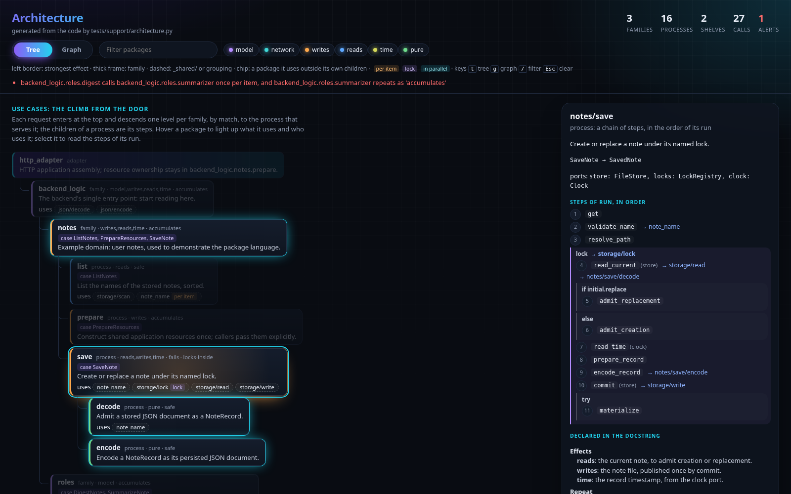
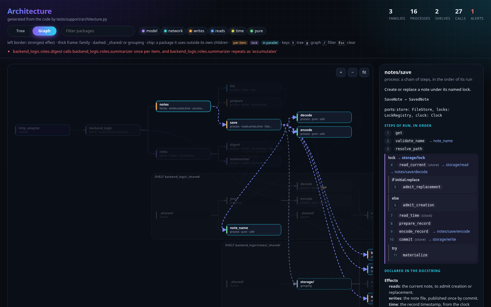
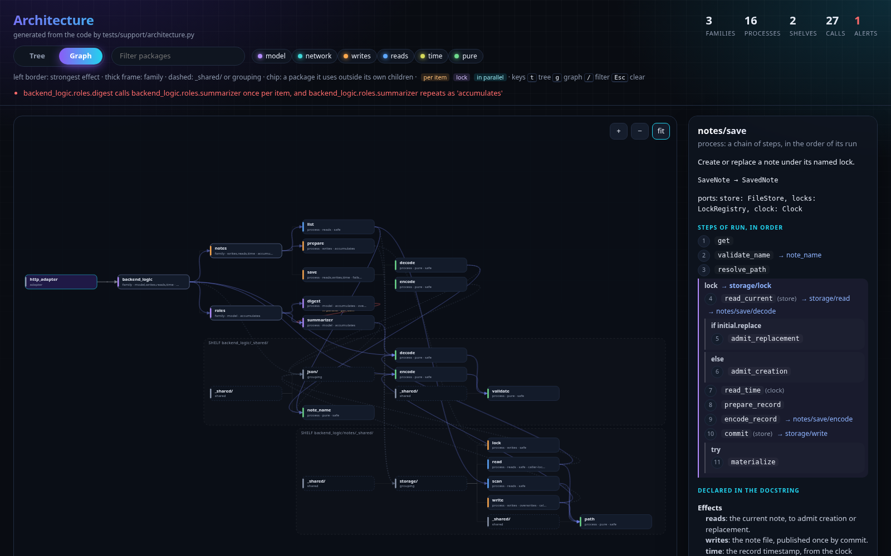

<p align="center"></p>

# pipefeuille

*Pipe* + *mille-feuille*: thin layers of the same shape, stacked, with one pipe running down through all of them.

Reference guide and template for new agent projects to be born in the style of **readable vertical pipelines**: fixed structure, fixed domain naming (`run`, `Pipe`, `Container`, `contracts`, `materialize`, verbs and suffixes) and one philosophy — the code is the blueprint, typed and rehearsed before the logic.

**Agent arriving now?** Start with [`RUNBOOK.md`](RUNBOOK.md): it tells you what your task is here (start a new project, work on a project born from the template, or maintain the pipefeuille itself) and the step-by-step for each one.

## Why it exists

**Errors are good for agents.** A type, lint or test error is cheap, local and precise feedback, and an agent can fix it on its own. The pipefeuille's structure exists to **turn a hole in a contract into a gate error**, and not into a silent bug.

The goal is for LLMs to assemble a new project in waves:

1. **Frontier model (orchestrator):** generates the entire architecture, with real contracts, Containers, signatures and `run` across the whole tree. The methods come out **strongly typed**, with body `raise NotImplementedError("package.method")`.
2. **Intermediate or smaller models (implementers):** several subagents in parallel fill in the methods, each respecting the types it received.
3. **Gates:** ruff, strict mypy and pytest catch whoever broke the contract. The implementer fixes it from the error, without needing to understand the whole project.

The complete step-by-step (waves 0 to 5, delegation package template, implementer report, how the orchestrator closes each delivery) is in [`template/docs/design/construction.md`](template/docs/design/construction.md).

Why it works:

- **End-to-end view in a single window.** The frontier model sees the whole pipelines in the same context: the climb through `match`, the Containers, the requests and the products. Architecture decisions stay with whoever has that view.
- **The implementer does not need global context.** The signature, the Container fields it reads and writes, the effects, the failures and the fixtures are enough (item 3 of "Process" in [`AGENTS.md`](template/AGENTS.md)).
- **Typing as specification.** The more the frontier model types, the less room the implementer has to break the contract. That is why the template uses `Literal` for codes and phases, `NewType` for numbers with their own role, and `Any` only at registered boundaries (guide §6).

## The architecture documents itself

No diagram is drawn by hand. Every project born from the template carries `tests/support/architecture.py`, which reads the code and the closed docstring of each `def run`, and prints the current map:

```fish
uv run python tests/support/architecture.py                                  # tree, for agents
uv run python tests/support/architecture.py --json                           # the whole graph
uv run python tests/support/architecture.py --html .dumps/architecture.html  # page for humans
```

- **Steps of each `run`, in order.** The tool reads the Pipe methods and the `<alias>.run(...)` calls, and the frames around them: lock, `if`/`else`, `match`/`case`, loop, `TaskGroup` and `try`. It marks each call `per-item`, `lock` or `parallel`.
- **Declared against derived.** Effects, repeat, loops and concurrency come from the docstring, with values from closed enums. The gates fail a value outside the enums, a declaration the code refutes, a package that no call reaches, and an imported `run` that no step makes.
- **Alerts.** A `per-item` call into a package that is not `safe` to repeat is listed for the reader to confirm. It does not fail the build.

The page is a single file that never touches the network. It shows the use-case tree, with the `_shared/` shelves apart, and a panel with the steps of the selected package:



A **Tree / Graph** toggle draws every call at once. Hovering a package traces only its calls:



Here is the whole graph. It is busier on purpose; the tree is the reading path:



The rules behind it are in [guide §2.2](template/docs/design/vertical-pipelines.md) and [template-decisions E1, E2](template/docs/design/template-decisions.md).

## Who can touch what

The structure belongs to the frontier model. The intermediate and smaller models only touch the method they received by delegation.

| Artifact | Frontier model | Intermediate / smaller model |
| --- | --- | --- |
| `run.py` (composition, `match`, `TaskGroup`, locks; docstring with closed sections) | writes and changes | does not touch |
| `contracts.py` (requests, products, errors, `Literal`, `NewType`, `Protocol`) | writes and changes | does not touch |
| `container.py` (fields and types) | writes and changes | does not touch |
| `pipeline.py`: signature, "Require …; set …" docstring, method order | writes and changes | does not touch |
| `pipeline.py`: **body of the delegated method** | delivers as `raise NotImplementedError("package.method")` | **fills in only this body** |
| Folder structure (no `__init__.py`) | writes | does not touch |
| Method tests and fixtures | writes (or approves) | runs; does not change them to make them pass |
| Gates (`pyproject.toml`: ruff, mypy, pytest) | configures | runs; never relaxes |

If the implementer concludes that the contract is wrong or incomplete (missing field, type too wide, undeclared error), they **stop and report to the frontier model**. They do not work around it with `cast`, `# type: ignore`, a new field or an extra import.

In the documents, the roles are called **frontier model**, **intermediate model** and **smaller model**, never by product name.

## What is here

In the order a new agent should read:

| # | Path | Purpose |
| --- | --- | --- |
| 0 | [`RUNBOOK.md`](RUNBOOK.md) | **Entry point:** what your task is and its step-by-step. |
| 1 | [`template/docs/design/reading-order.md`](template/docs/design/reading-order.md) | **Where to start**, by role (orchestrator or implementer). |
| 2 | [`template/AGENTS.md`](template/AGENTS.md) | Imperative rules, with `<!-- FILL IN -->` gaps for the new project's owner decisions. |
| 3 | [`template/`](template/) | Minimal Python 3.15 project (`lazy` imports) that runs and passes the gates: real examples of each pattern. Read the code starting from `backend_logic/run.py`. |
| 4 | [`template/docs/design/vertical-pipelines.md`](template/docs/design/vertical-pipelines.md) | **The guide.** Principles, package anatomy, vocabulary, composition in `run`, Container, typing, effects/receipts, two applications, LLM agents, rehearsal process, delegation, anti-patterns, checklist and what each project decides. |
| 5 | [`template/docs/design/vocabulary.md`](template/docs/design/vocabulary.md) | Defined names, conventions and proposals under observation. |
| 6 | [`template/docs/design/template-decisions.md`](template/docs/design/template-decisions.md) | The why of each template rule, the gate that guards it and what the gate does not prove. |
| 7 | [`template/docs/design/construction.md`](template/docs/design/construction.md) | Step-by-step of the construction in waves. |
| 8 | [`template/docs/design/architecture-log.md`](template/docs/design/architecture-log.md) | Decision log **of the new project**; it is born empty, with format and example. |
| 9 | [`skills/reverse-engineering/SKILL.md`](skills/reverse-engineering/SKILL.md) | Skill for rebuilding an existing app with behavior parity: observe the source segment by segment in isolation, then type and rehearse. |

## Start a new project

```fish
rsync -a --exclude .venv --exclude '.*_cache' --exclude __pycache__ ~/git/my/pipefeuille/template/ ~/git/my/my-project/
cd ~/git/my/my-project
git init
uv sync
uv run ruff check .; and uv run ruff format --check .; and uv run mypy .; and uv run pytest
```

What to do afterwards is in [`RUNBOOK.md`](RUNBOOK.md), task A.